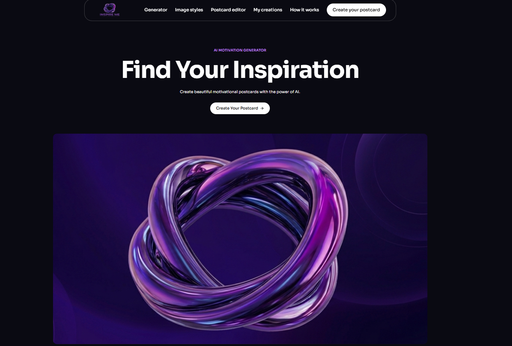

# ✨ InspireMe — Твоя щоденна порція натхнення

## 💜 Про проєкт

**InspireMe** — це вебзастосунок, створений для тих моментів, коли хочеться знайти натхнення, отримати підтримку або просто почути слова, які допоможуть рухатися вперед.

Ідея проєкту виникла з простого бажання — зробити натхнення доступним кожному. Іноді одна влучна цитата може змінити настрій, повернути віру в себе, допомогти не здаватися та нагадати, що навіть маленькі кроки наближають до великої мети.

Саме тому було створено InspireMe — простір, де штучний інтелект поєднується з творчістю, естетикою та позитивними емоціями.

## 🖥️ Головна сторінка InspireMe

## 🌟 У чому особливість InspireMe?

Головна особливість сайту — можливість створювати персоналізовані мотиваційні листівки відповідно до власного настрою, думок та інтересів.

Користувач може самостійно обрати тему або ввести будь-яке слово, яке його надихає. На основі цього штучний інтелект генерує унікальну мотиваційну цитату.

Після цього можна підібрати зображення, обрати візуальний стиль, відредагувати листівку та зберегти готовий результат.

## 🎨 Можливості сайту

- **Генерація цитат** — створення мотиваційних висловів за допомогою штучного інтелекту.
- **Вибір теми** — успіх, освіта, дружба, кохання, мрії, життя або власна тема користувача.
- **Пошук зображень** — підбір фотографій, які відповідають обраній тематиці.
- **Стилі зображень** — природа, гори, захід сонця, абстракція, мінімалізм та осіння вулиця.
- **Редактор листівок** — можливість персоналізувати створену листівку.
- **Мої роботи** — перегляд власних творчих робіт.
- **Завантаження** — збереження готових мотиваційних листівок.

## 🤖 Використання штучного інтелекту

У InspireMe штучний інтелект відіграє важливу роль. Завдяки інтеграції OpenAI API користувач отримує мотиваційні цитати, створені відповідно до введеної теми.

Для пошуку візуального контенту використовується Unsplash API, який дозволяє знаходити фотографії для оформлення листівок.

Таким чином, технології штучного інтелекту допомагають перетворити звичайну ідею або слово на персоналізований творчий результат.

## 🛠️ Технології, використані під час розробки

**Frontend:**

- React
- JavaScript
- Vite
- Tailwind CSS

**Backend:**

- Python
- Flask
- Flask-CORS

**API та інтеграції:**

- OpenAI API
- Unsplash API

## 🎯 Мета проєкту

Мета InspireMe — показати, як сучасні технології та штучний інтелект можуть використовуватися не лише для вирішення складних завдань, а й для творчості, самовираження та створення позитивних емоцій.

Цей проєкт демонструє можливості поєднання веброзробки, штучного інтелекту та дизайну в одному інтерактивному застосунку.

## 💭 Наша ідея

Ми не завжди можемо змінити обставини, але можемо змінити своє ставлення до них.

Іноді достатньо одного слова, однієї думки або однієї цитати, щоб знайти сили рухатися далі.

**InspireMe — знайди своє натхнення, створи власну листівку та поділися позитивом!** 💜

---

**Розробниця:** Yaryna Romaniuk

**Проєкт:** InspireMe — AI Motivational Postcard Generator
